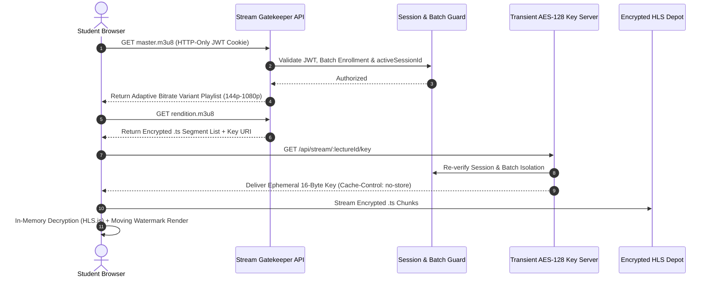
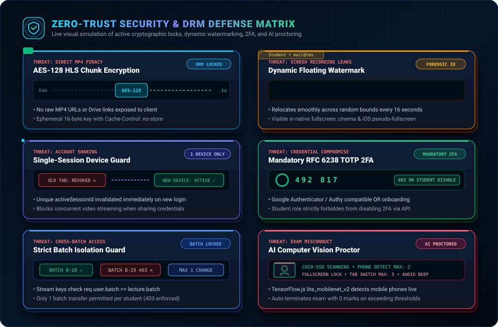
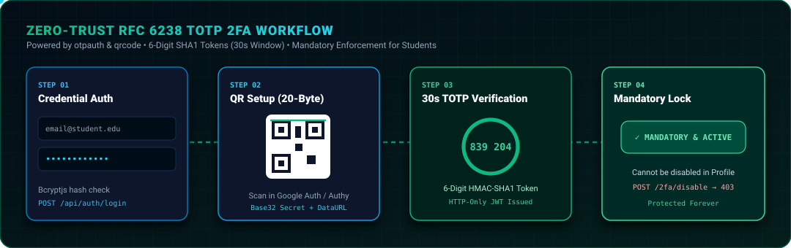
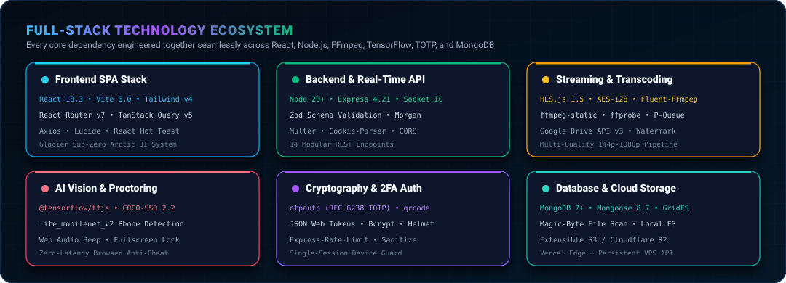

<div align="center">

<!-- ANIMATED GLACIER HERO BANNER -->


<br />
<br />

<!-- TECH & SECURITY BADGES -->
[](https://react.dev/)
[](https://vitejs.dev/)
[](https://tailwindcss.com/)
[](https://nodejs.org/)
[](https://expressjs.com/)
[](https://www.mongodb.com/)

<br />

[](https://socket.io/)
[](https://github.com/video-dev/hls.js)
[](https://www.tensorflow.org/js)
[](https://datatracker.ietf.org/doc/html/rfc6238)
[](https://github.com/shubham-gayke)
[](#-author--intellectual-property)

<br />
<br />

<p align="center">
  <strong>Enterprise-Grade, AI-Proctored, DRM-Protected Full-Stack MERN Learning Management System</strong><br />
  <em>Engineered with Adaptive AES-128 HLS Video Transcoding, Mandatory TOTP 2FA, TensorFlow.js Computer Vision Proctoring, Real-Time Socket.IO Collaboration, GridFS Notes, and an Integrated Tech Job Portal.</em>
</p>

[System Architecture](#-system-architecture) • [Security Matrix](#️-security--drm-architecture) • [Video Engine](#-custom-vlc-video-engine--hls-pipeline) • [AI Proctoring](#-ai-proctored-exam-suite) • [TOTP 2FA](#-zero-trust-totp-2fa-workflow) • [Tech Stack](#-full-stack-technology-ecosystem) • [Quick Start](#-getting-started)

</div>

<div align="center">
  
</div>

## 🌟 Platform Vision & Engineering Highlights

**Mentore Solution LMS** solves the toughest challenges faced by modern technical academies—**video piracy, credential sharing, cross-batch snooping, and unproctored online exams**—inside a unified, responsive Glacier-themed MERN platform.

<table>
  <tr>
    <td width="50%" valign="top">
      <h3>🎬 Zero-Leak Video Streaming</h3>
      <ul>
        <li><b>Google Drive API v3 Ingestion</b>: Trainers submit private OBS recordings cleanly without ever leaking Drive links to the browser.</li>
        <li><b>AES-128 HLS Chunking</b>: <code>fluent-ffmpeg</code> + <code>p-queue</code> transcode recordings into <b>144p–1080p</b> encrypted <code>.ts</code> segments with ephemeral keys.</li>
        <li><b>Forensic Watermarking</b>: Student identity overlays smoothly relocate every <b>16 seconds</b> across the viewport.</li>
      </ul>
    </td>
    <td width="50%" valign="top">
      <h3>🤖 Zero-Trust Auth &amp; AI Integrity</h3>
      <ul>
        <li><b>Mandatory RFC 6238 TOTP 2FA</b>: Powered by <code>otpauth</code> + <code>qrcode</code>; student accounts are server-locked against disabling 2FA (<code>403 Forbidden</code>).</li>
        <li><b>Single-Device Guard</b>: Unique <code>activeSessionId</code> tracking automatically logs out stale tabs and prevents account sharing.</li>
        <li><b>TensorFlow.js AI Proctor</b>: Real-time <code>coco-ssd</code> mobile phone vision detection, fullscreen lockdown, tab-blur telemetry, and audio alerts.</li>
      </ul>
    </td>
  </tr>
</table>

<div align="center">
  
</div>

## 🏛️ System Architecture

> Live multi-tier request and real-time packet flow spanning the **React 18 SPA**, **Express Zero-Trust Gateway**, **FFmpeg / Socket.IO Workers**, and **MongoDB Atlas + GridFS Storage**.

<div align="center">
  
</div>

<br />

<details>
<summary><b>🔍 Expand Cryptographic HLS Key Exchange Sequence Diagram</b></summary>
<br />



</details>

<div align="center">
  
</div>

## 🛡️ Security & DRM Architecture

> Interactive 3D visualization of every threat vector mitigated across the streaming, authentication, batch-access, and assessment layers.

<div align="center">
  
</div>

<div align="center">
  
</div>

## 🎬 Custom VLC Video Engine & HLS Pipeline

<div align="center">
  
</div>

<details>
<summary><b>⌨️ View Player Capabilities &amp; Keyboard Shortcuts</b></summary>
<br />

| Control / Feature | Behavior &amp; Implementation |
| :--- | :--- |
| **Adaptive Bitrate (`hls.js`)** | Dynamic quality switching (`Auto`, `144p` through `1080p`) with seamless buffering recovery |
| **Dynamic Watermark (`Watermark.jsx`)** | Displays `FirstName LastName • Email`, smoothly repositioning every **16 seconds** within `10%–75%` bounds |
| **Variable Speeds** | Smooth `0.5x`, `0.75x`, `1x`, `1.25x`, `1.5x`, and `2x` playback presets |
| **Keyboard Shortcuts** | `Space` / `K` (Play/Pause) • `←` / `→` (±5s Skip) • `↑` / `↓` (Volume) • `M` (Mute) • `F` (Fullscreen) |
| **Mobile Ergonomics** | Left/Right double-tap ripple seek (±5s), landscape orientation lock, and iOS pseudo-fullscreen fallback |
| **Smart Resume &amp; Q&amp;A Jump** | Automatically restores playback position; clicking any Q&amp;A timestamp executes `seekTo(seconds)` directly |

</details>

<div align="center">
  
</div>

## 🤖 AI-Proctored Exam Suite

> Browser-native computer vision and behavioural lockdown powered by **`@tensorflow/tfjs`** and **`@tensorflow-models/coco-ssd`** (`lite_mobilenet_v2`), ensuring zero-cost scalable exam integrity without external SaaS fees.

<div align="center">
  
</div>

### Key Exam Integrity Rules Enforced in `TakeExamPage.jsx`:
- **Live Mobile Phone Detection**: Client-side COCO-SSD object inference continuously scans webcam video frames; exceeding **2 mobile phone warnings** automatically terminates the exam with `0` score and records violation telemetry.
- **Fullscreen &amp; Focus Guard**: Listens to `fullscreenchange`, `visibilitychange`, and `window.blur`; exceeding **5 tab switches / focus losses** triggers automatic termination.
- **Web Audio Alert Synthesizer**: Generates immediate native Web Audio frequency alerts (`playAlertBeep`) on infractions.
- **Instant Hardware Release**: Explicitly halts and clears all `MediaStream` camera tracks the instant an assessment transitions to `submitted` or `terminated`.
- **Trainer Marks Matrix**: Compiles student attempts, passing statuses, durations, and violation logs cleanly inside `MarksMatrixPage.jsx`.

<div align="center">
  
</div>

## 🔐 Zero-Trust TOTP 2FA Workflow

> RFC 6238 compliant Time-Based One-Time Password security built natively with **`otpauth`** and **`qrcode`**, enforced end-to-end across UI and API layers.

<div align="center">
  
</div>

- **Standardized TOTP Secrets**: 20-byte cryptographic Base32 secrets issued under `Mentore Solution` (`SHA1`, `6` digits, `30s` rolling window).
- **Universal Compatibility**: Works out of the box with Google Authenticator, Microsoft Authenticator, Authy, and 1Password.
- **Mandatory Student Policy**: Student profiles display a locked **`Mandatory & Active`** indicator, and `POST /api/2fa/disable` rejects student-role requests with HTTP `403 Forbidden`.

<div align="center">
  
</div>

## 🧈 Full-Stack Technology Ecosystem

<div align="center">
  
</div>

<br />

<details>
<summary><b>📦 Complete Verified Package Inventory (Client &amp; Server)</b></summary>
<br />

| Layer | Core Packages &amp; Versions |
| :--- | :--- |
| **Frontend UI &amp; State** | `react` `^18.3.1`, `react-dom` `^18.3.1`, `vite` `^6.0.0`, `tailwindcss` `^4.0.0`, `react-router-dom` `^7.1.0`, `@tanstack/react-query` `^5.62.0`, `axios` `^1.7.9`, `lucide-react` `^0.468.0`, `react-hot-toast` `^2.4.1`, `clsx` `^2.1.1`, `tailwind-merge` `^2.6.0` |
| **Streaming &amp; AI Vision** | `hls.js` `^1.5.17`, `socket.io-client` `^4.8.1`, `@tensorflow/tfjs` `^4.22.0`, `@tensorflow-models/coco-ssd` `^2.2.3` |
| **Backend Core &amp; Realtime** | `express` `^4.21.0`, `mongoose` `^8.7.0`, `socket.io` `^4.7.5`, `zod` `^3.23.8`, `uuid` `^10.0.0`, `dotenv` `^16.4.5`, `morgan` `^1.10.0`, `multer` `^1.4.5-lts.1` |
| **Media &amp; Cloud Ingestion** | `googleapis` `^140.0.1`, `fluent-ffmpeg` `^2.1.3`, `ffmpeg-static` `^5.2.0`, `ffprobe-static` `^3.1.0`, `p-queue` `^8.0.1` |
| **Security &amp; TOTP Auth** | `otpauth` `^9.6.0`, `qrcode` `^1.5.4`, `jsonwebtoken` `^9.0.2`, `bcryptjs` `^2.4.3`, `helmet` `^7.1.0`, `cors` `^2.8.5`, `cookie-parser` `^1.4.6`, `express-rate-limit` `^7.4.0`, `express-mongo-sanitize` `^2.2.0` |

</details>

<div align="center">
  
</div>

## ✨ Additional Core Modules

- **💼 Integrated Tech Career Portal (`/jobs`)**: Curated Full-Time, Internship, and Contract openings with skill tag filtering, batch targeting, real-time Socket.IO broadcasts, and official career page links (`ManageJobsPage.jsx` / `JobPortalPage.jsx`).
- **💬 Real-Time Lecture Q&amp;A (`questions.js`)**: Timestamped lecture inquiries, optional peer-anonymous mode, private 1-on-1 trainer messaging, and live notification badges.
- **📚 GridFS Study Notes Vault (`notes.js`)**: Magic-byte verified PDF and image uploads stored in MongoDB GridFS, configurable download toggles, in-page document viewers, and private autosaved student scratchpads (`PrivateNote`).
- **👥 Email Whitelist &amp; Strict Batch Governance**: Pre-approved email allowlisting (`AllowedEmail`), B-26 through B-31 batch management, and server-enforced single batch change limit.
- **🐞 Built-in Bug Reporting System**: Dedicated issue submission workflow (`ReportBugPage.jsx`) backed by `BugReport` persistence.

<div align="center">
  
</div>

## 📂 Project Architecture Tree

```text
├── package.json                       # Root workspace orchestrator (concurrently)
├── README.md                          # Animated documentation & architecture showcase
├── docs/assets/                       # Custom animated Glacier SVG assets
├── client/                            # Frontend React 18 + Vite 6 + Tailwind CSS v4
│   ├── .env.example
│   ├── vite.config.js
│   └── src/
│       ├── api/                       # Axios API modules (auth, exams, jobs, lectures, notes)
│       ├── components/
│       │   ├── common/                # Button, Input, Modal, Skeleton, EmptyState
│       │   ├── layout/                # Navbar, StudentLayout, TrainerLayout, BatchGuard
│       │   ├── lecture/               # NotesTab, AskTrainerTab, LectureInfoTab
│       │   └── player/                # CustomVideoPlayer (hls.js), Watermark
│       ├── contexts/                  # AuthContext, ThemeContext, SocketContext
│       └── pages/
│           ├── auth/                  # Login, Register, ForgotPassword, TwoFactorSetup/Login
│           ├── student/               # Dashboard, SelectBatch, LecturePage, TakeExamPage, JobPortal
│           └── trainer/               # TrainerDashboard, ManageExams, MarksMatrix, ManageJobs
└── server/                            # Backend Node.js 20+ / Express / Socket.IO API
    ├── .env.example
    └── src/
        ├── config/                    # Environment validation & MongoDB Atlas connection
        ├── jobs/                      # Video transcoding worker queue (p-queue concurrency 1)
        ├── middleware/                # JWT auth guard, role guard, rate limiters, Zod validator
        ├── models/                    # 12 Mongoose schemas (User, Batch, Lecture, Exam, Job, Note...)
        ├── routes/                    # 14 REST routers (auth, twoFactor, exams, stream, jobs...)
        ├── services/                  # driveService, hlsService, storageService
        ├── socket/                    # Socket.IO batch rooms & notification dispatcher
        ├── seed.js                    # Standalone database initializer
        └── index.js                   # HTTP & WebSocket server bootstrap
```

<div align="center">
  
</div>

## 🛠️ Getting Started

### Prerequisites
- **Node.js** `v20.0.0+` and **npm** `v10.0.0+`
- **MongoDB** (Local Community Server or [MongoDB Atlas](https://www.mongodb.com/atlas))

### 1. Clone &amp; Install Dependencies
```bash
git clone https://github.com/shubham-gayke/Learning-Management-System.git
cd Learning-Management-System
npm run install:all
```

### 2. Configure Environment Variables
Copy the provided templates and populate your own private secrets (**never commit `.env` files**):

```bash
cp server/.env.example server/.env
cp client/.env.example client/.env
```

<details>
<summary><b>⚙️ View Required Environment Variables Reference</b></summary>
<br />

**`server/.env`**
```env
PORT=5000
NODE_ENV=development
MONGODB_URI=mongodb://127.0.0.1:27017/mentore_lms
JWT_SECRET=replace_with_your_32_plus_char_random_secret_key
JWT_EXPIRES_IN=7d
CLIENT_URL=http://localhost:5173

# Configure your private admin/trainer seed values locally
TRAINER_FIRST_NAME=Admin
TRAINER_LAST_NAME=Trainer
TRAINER_EMAIL=trainer@yourdomain.com
TRAINER_PASSWORD=<CreateYourStrongPasswordHere123!>

# Enforce single active device login per account
ALLOW_MULTIPLE_SESSIONS=false

# Google Drive Service Account (Optional locally; required for OBS Drive ingestion)
GOOGLE_SERVICE_ACCOUNT_KEY_FILE=./secrets/service-account.json

# Storage Settings
STORAGE_DRIVER=local
HLS_STORAGE_PATH=./storage/hls
MAX_NOTE_SIZE_MB=15
```

**`client/.env`**
```env
VITE_API_URL=http://localhost:5000
```

</details>

### 3. Seed Initial Batches &amp; Launch
```bash
# Seed initial batches (B-26 to B-31) and your configured trainer account
npm run seed

# Start Express Backend (:5000) and Vite Frontend (:5173) concurrently
npm run dev
```

<details>
<summary><b>🔑 Google Cloud Drive Setup (For OBS Lecture Ingestion)</b></summary>
<br />

1. Open [Google Cloud Console](https://console.cloud.google.com/) and create a project.
2. Enable the **Google Drive API**.
3. Under **Credentials**, create a **Service Account** with **Viewer** permissions.
4. Generate a JSON private key and save it to `server/secrets/service-account.json` (gitignored).
5. Share your Google Drive lecture recordings folder with the Service Account email address.
6. Paste any Drive file share URL inside the Trainer Upload portal—the backend automatically ingests, transcodes, and encrypts it into HLS segments.

</details>

<div align="center">
  
</div>

## ☁️ Production Deployment Architecture

1. **Frontend (Vercel / Edge CDN)**:
   - Root Directory: `client` • Build Command: `npm run build` • Output Directory: `dist`
   - Configure `VITE_API_URL` pointing to your live backend HTTPS domain.
2. **Backend (Dedicated VPS / Persistent Container)**:
   - Multi-quality FFmpeg transcoding requires persistent storage and sustained CPU cycles (recommended minimum **2 vCPU / 4 GB RAM** on Render Persistent Disk, AWS EC2, DigitalOcean, or Hetzner).
   - Optionally switch `STORAGE_DRIVER=s3` for AWS S3 or Cloudflare R2 segment offloading.

<div align="center">
  
</div>

## 👨‍💻 Author &amp; Intellectual Property

- **Lead Architect &amp; Developer**: **Shubham Gayke**
- **Platform**: **Mentore Solution LMS**
- **Copyright**: © 2026 **Shubham Gayke**. All Rights Reserved.

---

<div align="center">
  
</div>
