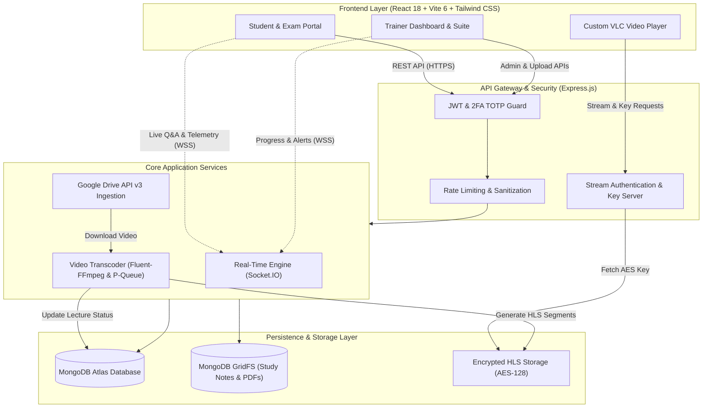
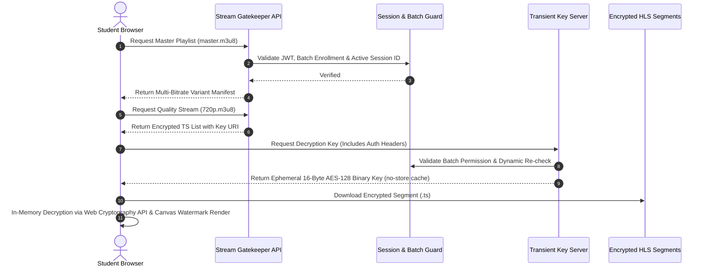

# Mentore Solution LMS — Full-Stack MERN Learning Management System

<div align="center">


[](https://react.dev/)
[](https://vitejs.dev/)
[](https://tailwindcss.com/)
[](https://nodejs.org/)
[](https://expressjs.com/)
[](https://www.mongodb.com/)
[](https://socket.io/)
[](https://github.com/video-dev/hls.js)
[](https://www.tensorflow.org/js)
[](https://en.wikipedia.org/wiki/Time-based_one-time_password)
[](LICENSE)
[](CONTRIBUTING.md)

<p align="center">
  <strong>Enterprise-Grade, AI-Proctored, DRM-Protected Full-Stack Learning Management System</strong><br>
  Engineered with Adaptive HLS Video Transcoding, Zero-Trust TOTP 2FA, Computer Vision Anti-Cheating, Real-Time WebSockets, and Curated Career Placement.
</p>

[Key Features](#-key-features) • [System Architecture](#-system-architecture) • [Tech Stack Butter](#-tech-stack-deep-dive) • [Security & DRM](#-security--drm-architecture) • [Getting Started](#-getting-started) • [Deployment](#-production-deployment)

</div>

---

## 🌟 Overview

**Mentore Solution LMS** is a state-of-the-art educational platform designed to provide a secure, low-latency, and interactive learning experience for high-stakes technical training. 

Traditional LMS setups suffer from video piracy, unauthorized account sharing, and lack of real-time academic proctoring. Mentore Solution resolves these challenges through:
- **AES-128 HLS Transcoded Streaming**: Automatic ingestion of OBS studio recordings from Google Drive, transcoding them into multi-bitrate renditions (144p to 1080p) encrypted with transient crypto keys.
- **Dynamic Floating Anti-Piracy Watermarking**: Personalized student metadata continuously moves across video viewports to prevent unauthorized screen-capture dissemination.
- **Mandatory RFC 6238 TOTP Two-Factor Authentication (2FA)**: Robust authentication via Google Authenticator, Authy, or Microsoft Authenticator, paired with strict device-session invalidation.
- **AI-Powered Proctoring Assessment Room**: Real-time browser lockdown, multi-face and absence detection via TensorFlow.js, tab-switching telemetry, and automated violation enforcement.
- **Integrated Tech Career Portal**: Directly bridges students to verified opportunities with targeted skill-matching and application tracking.

---

## 🏛️ System Architecture



### 🔒 Cryptographic HLS Key Exchange & Player Sequence



---

## 🧈 Tech Stack Deep Dive

Every component in Mentore Solution LMS has been meticulously selected for performance, security, and developer ergonomics:

### 🎨 Frontend Engineering
| Technology | Version | Purpose & Architectural Highlights |
| :--- | :--- | :--- |
| **React** | `v18.3` | Concurrent rendering, declarative component state, custom hooks for streaming and socket events. |
| **Vite** | `v6.0` | Ultra-fast HMR, optimized tree-shaking, production bundle minification with Rollup. |
| **Tailwind CSS** | `v4.0` | Modern, responsive utility-first CSS engine; custom Glacier and Night theme tokens with hardware-accelerated animations. |
| **React Router** | `v7.1` | Nested routing, role-based route guards (`BatchGuard`, `TrainerGuard`, `StudentGuard`), and instant navigation. |
| **TanStack Query** | `v5.62` | Async data synchronization, optimistic mutations, server-state caching, and automated revalidation. |
| **Lucide React** | `v0.468` | Crisp, accessible, lightweight vector iconography across all portal views. |
| **HLS.js** | `v1.5` | Client-side HTTP Live Streaming client with adaptive bitrate switching, buffer management, and key decryption. |
| **React Hot Toast** | `v2.4` | Unobtrusive, animated notification toasts for instant user feedback. |

### 🧠 Artificial Intelligence & Computer Vision
| Technology | Version | Purpose & Architectural Highlights |
| :--- | :--- | :--- |
| **TensorFlow.js** | `v4.22` | Browser-based machine learning inference engine executing entirely client-side with WebGL acceleration. |
| **COCO-SSD** | `v2.2` | Real-time object detection model evaluating video feeds for mobile phones, unauthorized accessories, and secondary individuals. |
| **Face & Gaze Tracker** | Custom | Computer vision pipeline monitoring student presence, multi-person intrusions, and prolonged gaze deviations during examinations. |

### ⚙️ Backend Architecture & Microservices
| Technology | Version | Purpose & Architectural Highlights |
| :--- | :--- | :--- |
| **Node.js** | `v20+` | Asynchronous, non-blocking runtime powering high-throughput API endpoints and file streaming. |
| **Express.js** | `v4.21` | Robust web application framework structured into modular routes, services, models, and controllers. |
| **Socket.IO** | `v4.8` | Real-time bidirectional event transport for lecture Q&A threads, live transcoding status updates, and proctoring telemetry. |
| **Fluent-FFmpeg** | `v2.1` | Media processing pipeline invoking bundled `ffmpeg-static` and `ffprobe-static` binaries (no system installation prerequisites). |
| **P-Queue** | `v8.0` | Controlled concurrency queue managing CPU-intensive video download and transcoding workloads without server exhaustion. |
| **Google APIs** | `v140.0` | Google Drive v3 integration for automated Service Account ingestion of trainer OBS lecture recordings. |

### 🔐 Security, Identity & Cryptography
| Technology | Purpose & Architectural Highlights |
| :--- | :--- |
| **RFC 6238 TOTP (`otpauth`)** | Time-based One-Time Password engine generating cryptographically secure secrets and verifying 6-digit tokens. |
| **QR Code Engine (`qrcode`)** | In-memory generation of standard OTP auth URI QR codes compatible with Google Authenticator and Authy. |
| **Two-Factor Enforcement** | Mandatory 2FA enrollment for student accounts with backend role-level blocks preventing unauthorized deactivation. |
| **JSON Web Tokens (`jsonwebtoken`)** | Signed stateless session bearer tokens carrying encrypted identity, role, and active session identifiers. |
| **Bcrypt.js** | Salted password hashing with optimal work factors to protect user authentication records. |
| **Helmet & Sanitization** | Comprehensive HTTP security headers, XSS prevention, and `express-mongo-sanitize` to neutralize NoSQL injection vectors. |
| **Express Rate Limit** | Multi-tier rate limiters shielding authentication, OTP verification, and streaming gateways against brute-force attacks. |

### 🗄️ Persistence & Storage
| Technology | Version | Purpose & Architectural Highlights |
| :--- | :--- | :--- |
| **MongoDB Atlas** | `v8.7 (Mongoose)` | Document-oriented NoSQL database managing users, batches, lectures, questions, exams, and job listings. |
| **MongoDB GridFS** | Native Driver | Chunked binary storage for lecture study documents (PDFs, images) with magic-byte MIME integrity validation. |
| **Storage Abstraction** | Custom Driver | Storage provider layer supporting local storage with direct pluggability for AWS S3 and Cloudflare R2 object storage. |

---

## 🛡️ Security & DRM Architecture

```
┌────────────────────────────────────────────────────────────────────────┐
│                        LAYERED SECURITY MATRIX                         │
├────────────────────────────────┬───────────────────────────────────────┤
│ Threat Vector                  │ LMS Mitigation Strategy               │
├────────────────────────────────┼───────────────────────────────────────┤
│ Direct MP4 Video Piracy        │ AES-128 HLS chunking; zero raw URLs;  │
│                                │ Right-click & DevTools download blocks│
├────────────────────────────────┼───────────────────────────────────────┤
│ Unauthorized Screen Recording  │ Dynamic floating watermark with name  │
│                                │ and email randomly shifting positions │
├────────────────────────────────┼───────────────────────────────────────┤
│ Account Credential Sharing     │ Single-session enforcement via        │
│                                │ activeSessionId; invalidates old tabs │
├────────────────────────────────┼───────────────────────────────────────┤
│ Credential Compromise          │ Mandatory 2FA (TOTP RFC 6238)         │
│                                │ Authenticator app required on login   │
├────────────────────────────────┼───────────────────────────────────────┤
│ Cross-Batch Unauthorized Access│ Strict route-level enrollment check;  │
│                                │ Stream tokens locked to batch ID      │
├────────────────────────────────┼───────────────────────────────────────┤
│ Exam Misconduct & Cheating     │ AI proctoring, webcam telemetry,      │
│                                │ tab blur alerts, fullscreen lockdown  │
└────────────────────────────────┴───────────────────────────────────────┘
```

---

## 🚀 Key Features

### 🎬 1. Custom VLC-Style Video Player
- **Adaptive Bitrate Streaming**: Switch seamlessly between 144p, 240p, 360p, 480p, 720p, and 1080p via HLS.js.
- **Dynamic Floating Watermark**: Unobtrusive overlay displaying student identity moving every 15–20s to trace unauthorized recordings.
- **Precision Playback Controls**: Variable playback rates (0.5x to 2x), ±5s quick jumps, keyboard hotkeys (`Space`, `K`, `M`, `F`, Arrow keys).
- **Mobile Gesture Integration**: Double-tap on left/right screen edges to seek backwards or forwards with ripple effects; auto-landscape orientation lock.
- **Smart Progress Autosave**: Resumes playback from the exact second where the student left off.

### 🛡️ 2. Two-Factor Authentication (2FA / TOTP)
- **Universal Authenticator Compatibility**: Supports Google Authenticator, Microsoft Authenticator, Authy, and 1Password.
- **Instant Setup**: Generates standardized QR codes and raw secret keys for seamless mobile scanning.
- **Mandatory Student Policy**: Security policies prevent students from turning off 2FA, securing academic content and user verification.
- **Rate-Limited Verification**: Guarded against automated token guessing with exponential backoff protections.

### 📝 3. AI-Proctored Exam Suite
- **Comprehensive Scheduler**: Trainers can schedule batch-specific or global exams with timed windows, question shuffling, and custom passing thresholds.
- **Live Computer Vision Proctor**: Real-time evaluation of webcam frames using TensorFlow.js to detect multiple persons, absence, or unauthorized devices.
- **System Lockdown Enforcement**: Automatic tracking of fullscreen exits, tab switches, and window blur events.
- **Automated Disqualification**: Reaching maximum violation thresholds terminates exams automatically and records full violation telemetry.
- **Instant Assessment Matrix**: Auto-grades objective questions and compiles detailed batch analytics.

### 💼 4. Tech Career Portal
- **Targeted Tech Opportunities**: Curated repository of Full-Time, Internship, and Contract roles across cloud, DevOps, software development, and Linux engineering.
- **Smart Skill Matching**: Dynamic filtering by technology (e.g., AWS, Docker, Kubernetes, Linux, Python).
- **Verified Job Postings**: Comprehensive job descriptions with direct links to official company career portals.

### 💬 5. Real-Time Collaborative Q&A
- **Timestamped Inquiries**: Students can pin questions directly to video timestamps; clicking a question jumps the player to that exact moment.
- **Privacy Controls**: Options for standard public queries, anonymous queries (identity masked from peers), or private 1-on-1 trainer discussions.
- **Instant WebSocket Notifications**: Real-time chat bubbles and unread badge counters powered by Socket.IO.

### 📁 6. Lecture Notes & GridFS Storage
- **Magic-Byte Verified Uploads**: Validates file headers to ensure binary integrity and block MIME-type spoofing.
- **Integrated PDF & Image Viewer**: Read course documentation and inspect architectural schematics without leaving the portal.
- **Configurable Permissions**: Trainers toggle download allowances per document; students maintain private autosaved lecture scratchpads.

---

## 📂 Repository Structure

```text
├── package.json                   # Monorepo root with concurrent dev orchestrator
├── .gitignore                     # Git exclusion rules
├── README.md                      # Comprehensive project documentation
├── client/                        # Frontend Single Page Application (React 18)
│   ├── .env.example               # Client environment variable blueprint
│   ├── vite.config.js             # Vite configuration with Tailwind CSS v4
│   ├── package.json               # Client dependencies and scripts
│   └── src/
│       ├── api/                   # Axios API services (auth, exams, lectures, jobs, notes)
│       ├── components/            # Reusable UI component library
│       │   ├── common/            # Button, Modal, Input, Skeleton, EmptyState
│       │   ├── exam/              # ExamTimer, QuestionCard, AIProctorView, ViolationModal
│       │   ├── layout/            # Navbar, StudentLayout, TrainerLayout, BatchGuard
│       │   ├── lecture/           # NotesTab, AskTrainerTab, LectureInfoTab
│       │   └── player/            # CustomVideoPlayer, Watermark, QualitySelector
│       ├── contexts/              # AuthContext, ThemeContext, SocketContext
│       └── pages/
│           ├── auth/              # LoginPage, RegisterPage, Setup2FAPage, Verify2FAPage
│           ├── student/           # Dashboard, SelectBatch, LecturePage, ExamRoom, JobsPage
│           └── trainer/           # TrainerDashboard, ExamScheduler, JobManager, Students
└── server/                        # Backend REST API & Real-time Server (Node.js)
    ├── .env.example               # Server environment variable blueprint
    ├── package.json               # Server dependencies and scripts
    └── src/
        ├── config/                # Environment parser and MongoDB connector
        ├── jobs/                  # Video transcoding worker queue (p-queue)
        ├── middleware/            # JWT auth, rate limiter, validation, error handler
        ├── models/                # Mongoose schemas (User, Batch, Lecture, Exam, Job, Note)
        ├── routes/                # Express endpoints (auth, twoFactor, exams, stream, jobs)
        ├── services/              # driveService, hlsService, storageService
        ├── socket/                # Socket.IO room manager and event emitters
        ├── seed.js                # Database seeder (batches and initial trainer account)
        └── index.js               # Main HTTP/WebSocket server bootstrap
```

---

## 🛠️ Getting Started

### Prerequisites
- **Node.js**: `v20.0.0` or higher
- **npm**: `v10.0.0` or higher
- **MongoDB**: Local MongoDB instance (`mongodb://127.0.0.1:27017`) or a free [MongoDB Atlas Cluster](https://www.mongodb.com/atlas)

### 1. Clone the Repository
```bash
git clone https://github.com/shubham-gayke/Learning-Management-System.git
cd Learning-Management-System
```

### 2. Install Dependencies
Install dependencies across the root, client, and server with a single command:
```bash
npm run install:all
```

### 3. Configure Environment Variables

#### Backend Configuration (`server/.env`)
Copy the template and adjust values:
```bash
cp server/.env.example server/.env
```

Edit `server/.env`:
```env
PORT=5000
NODE_ENV=development
MONGODB_URI=mongodb://127.0.0.1:27017/mentore_lms
JWT_SECRET=your_super_secret_jwt_key_at_least_32_characters_long
JWT_EXPIRES_IN=7d
CLIENT_URL=http://localhost:5173

# Initial Lead Trainer Configuration (Used when running npm run seed)
TRAINER_FIRST_NAME=Admin
TRAINER_LAST_NAME=Trainer
TRAINER_EMAIL=trainer@yourdomain.com
TRAINER_PASSWORD=CreateYourStrongPasswordHere123!

# Security & Concurrency
ALLOW_MULTIPLE_SESSIONS=false

# Google Drive Service Account (Optional for local testing; required for Drive OBS ingestion)
GOOGLE_SERVICE_ACCOUNT_KEY_FILE=./secrets/service-account.json

# Storage Drivers
STORAGE_DRIVER=local
HLS_STORAGE_PATH=./storage/hls
MAX_NOTE_SIZE_MB=15
```

#### Frontend Configuration (`client/.env`)
```bash
cp client/.env.example client/.env
```

Edit `client/.env`:
```env
VITE_API_URL=http://localhost:5000
```

### 4. Initialize Database & Seed Batches
Populates initial batches (B-26 to B-31) and configures the default trainer account specified in your `server/.env`:
```bash
npm run seed
```

### 5. Launch Development Environment
Starts both the Express API server and the Vite development server concurrently:
```bash
npm run dev
```

- **Frontend Application**: `http://localhost:5173`
- **Backend API Server**: `http://localhost:5000`
- **API Health Check**: `http://localhost:5000/api/health`

---

## 🔑 Google Cloud Setup (Optional: OBS Drive Ingestion)

To enable automatic downloading and transcoding of OBS lecture recordings from Google Drive:

1. **Google Cloud Console**: Open [Google Cloud Console](https://console.cloud.google.com/) and create a project.
2. **Enable Drive API**: Search for and enable the **Google Drive API**.
3. **Create Service Account**: Navigate to **Credentials** > **Create Credentials** > **Service Account**. Assign the **Viewer** role.
4. **Generate Key**: Click the service account, navigate to **Keys** > **Add Key** > **Create new key** (JSON).
5. **Install Key**: Save the downloaded JSON file as:
   ```text
   server/secrets/service-account.json
   ```
6. **Share Folder**: In Google Drive, share your lecture recordings folder with the Service Account email (e.g., `service-account@project.iam.gserviceaccount.com`).
7. **Paste Link in Portal**: In the Trainer Dashboard, paste the video link (`https://drive.google.com/file/d/.../view`). The backend queue handles download, probe, and AES-128 HLS encryption automatically.

---

## ☁️ Production Deployment

### Recommended Topology
```
           ┌──────────────────────┐
           │   Vercel / Netlify   │  <─── High-Speed Global Edge CDN
           │ (React 18 SPA Build) │
           └──────────┬───────────┘
                      │
               HTTPS / WebSockets
                      │
           ┌──────────▼───────────┐
           │ Dedicated VPS / Cloud│  <─── Persistent Disk for HLS Transcoding
           │ (Render / EC2 / Droplet)     & Background FFmpeg Worker Queue
           └──────────┬───────────┘
                      │
           ┌──────────▼───────────┐
           │    MongoDB Atlas     │  <─── High Availability Database
           │   & GridFS Cluster   │       & Binary Document Store
           └──────────────────────┘
```

1. **Frontend Deployment (Vercel)**:
   - Root directory: `client`
   - Build command: `npm run build`
   - Output directory: `dist`
   - Environment variable: `VITE_API_URL=https://your-backend-api.com`

2. **Backend Deployment (Dedicated VPS or Render Web Service)**:
   - Multi-quality HLS transcoding with `fluent-ffmpeg` requires continuous CPU cycles and disk writes.
   - **Recommendation**: Deploy backend to a host with persistent storage (AWS EC2, DigitalOcean Droplet, Hetzner, or Render Web Service with Persistent Disks).
   - Ensure environment variables (`MONGODB_URI`, `JWT_SECRET`, `CLIENT_URL`) are configured in the cloud dashboard.

---

## 🤝 Contributing & Code of Conduct

Contributions make the open-source community an inspiring place to learn, inspire, and create. Any contributions you make are **greatly appreciated**.

1. Fork the Project
2. Create your Feature Branch (`git checkout -b feature/AmazingFeature`)
3. Commit your Changes (`git commit -m 'feat: Add some AmazingFeature'`)
4. Push to the Branch (`git push origin feature/AmazingFeature`)
5. Open a Pull Request

---

## 📄 License

Distributed under the **MIT License**. See [`LICENSE`](LICENSE) for more information.

<div align="center">
  <sub>Crafted with passion for scalable, secure technical education.</sub>
</div>
