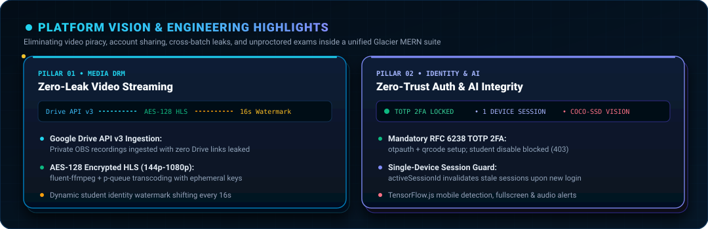
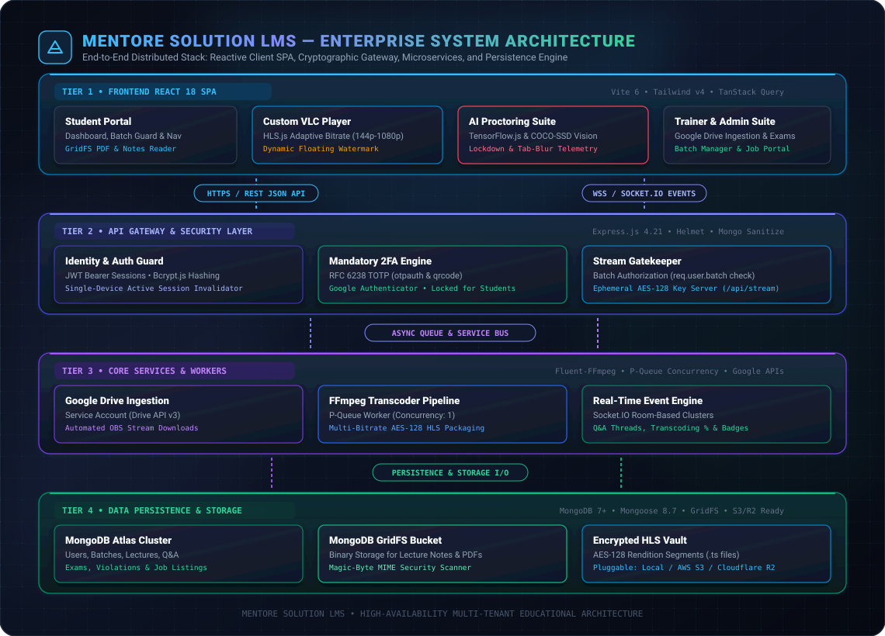
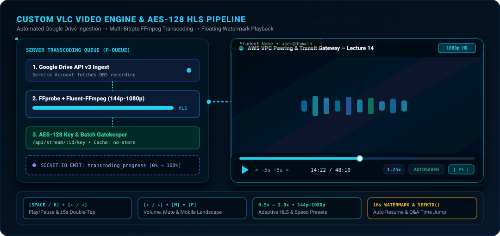
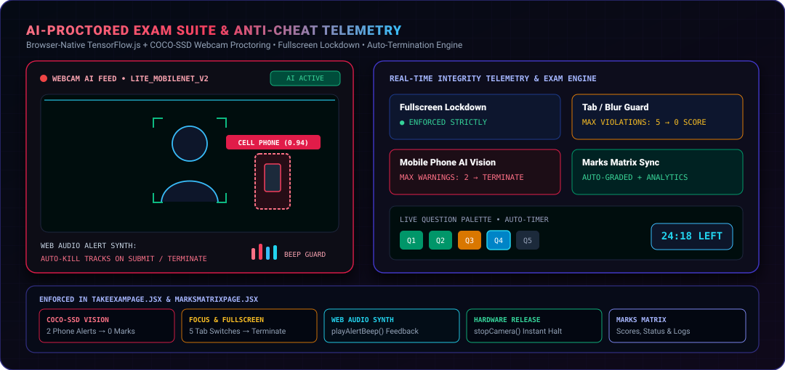
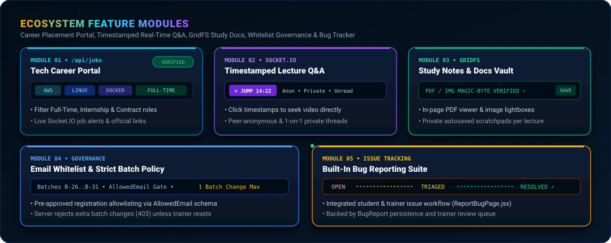
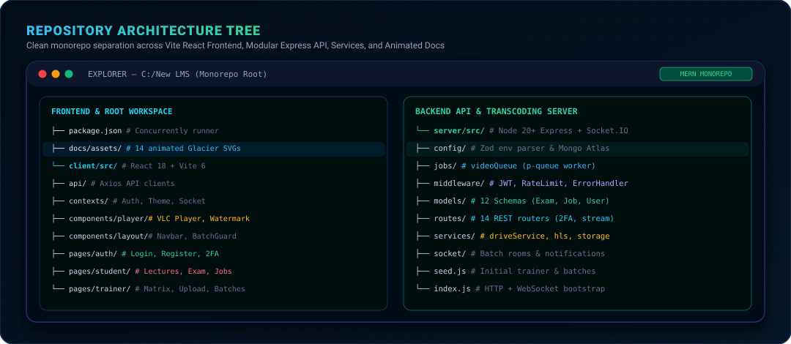
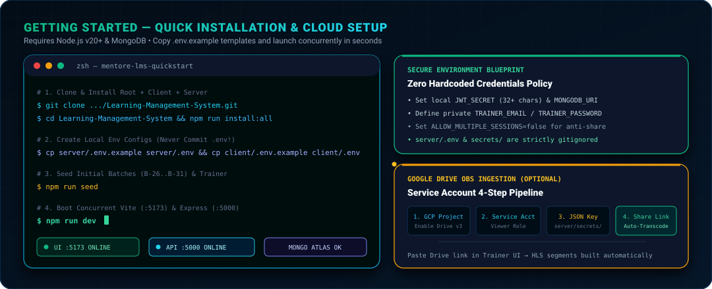
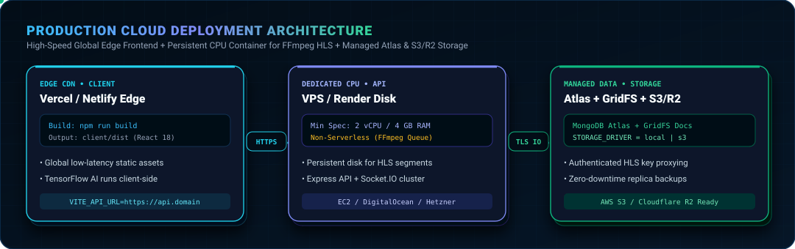

<div align="center">


[](https://react.dev/)
[](https://vitejs.dev/)
[](https://tailwindcss.com/)
[](https://nodejs.org/)
[](https://expressjs.com/)
[](https://www.mongodb.com/)
[](https://socket.io/)
[](https://github.com/video-dev/hls.js)
[](https://www.tensorflow.org/js)
[](https://datatracker.ietf.org/doc/html/rfc6238)
[](https://github.com/shubham-gayke)
[](https://github.com/shubham-gayke/Learning-Management-System)


























</div>

<details>
<summary><b>📋 Developer Reference: Click to Copy CLI Commands, .env Blueprint &amp; Package List</b></summary>
<br />

### Quick Start CLI
```bash
git clone https://github.com/shubham-gayke/Learning-Management-System.git
cd Learning-Management-System
npm run install:all
cp server/.env.example server/.env
cp client/.env.example client/.env
npm run seed
npm run dev
```

### Environment Blueprint (`server/.env`)
```env
PORT=5000
NODE_ENV=development
MONGODB_URI=mongodb://127.0.0.1:27017/mentore_lms
JWT_SECRET=replace_with_your_32_plus_char_random_secret_key
JWT_EXPIRES_IN=7d
CLIENT_URL=http://localhost:5173

TRAINER_FIRST_NAME=Admin
TRAINER_LAST_NAME=Trainer
TRAINER_EMAIL=trainer@yourdomain.com
TRAINER_PASSWORD=<CreateYourStrongPasswordHere123!>

ALLOW_MULTIPLE_SESSIONS=false
GOOGLE_SERVICE_ACCOUNT_KEY_FILE=./secrets/service-account.json
STORAGE_DRIVER=local
HLS_STORAGE_PATH=./storage/hls
MAX_NOTE_SIZE_MB=15
```

### Verified Package Inventory
- **Client**: `react` `^18.3.1`, `vite` `^6.0.0`, `tailwindcss` `^4.0.0`, `react-router-dom` `^7.1.0`, `@tanstack/react-query` `^5.62.0`, `axios` `^1.7.9`, `hls.js` `^1.5.17`, `socket.io-client` `^4.8.1`, `lucide-react` `^0.468.0`, `react-hot-toast` `^2.4.1`, `@tensorflow/tfjs` `^4.22.0`, `@tensorflow-models/coco-ssd` `^2.2.3`.
- **Server**: `express` `^4.21.0`, `mongoose` `^8.7.0`, `socket.io` `^4.7.5`, `otpauth` `^9.6.0`, `qrcode` `^1.5.4`, `jsonwebtoken` `^9.0.2`, `bcryptjs` `^2.4.3`, `googleapis` `^140.0.1`, `fluent-ffmpeg` `^2.1.3`, `ffmpeg-static` `^5.2.0`, `ffprobe-static` `^3.1.0`, `p-queue` `^8.0.1`, `helmet` `^7.1.0`, `zod` `^3.23.8`, `express-rate-limit` `^7.4.0`, `express-mongo-sanitize` `^2.2.0`.

</details>
